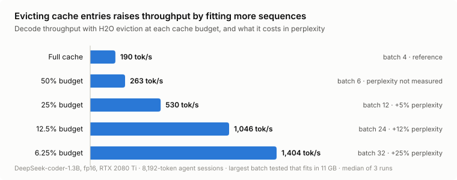
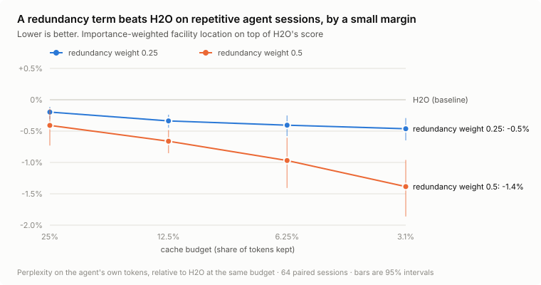
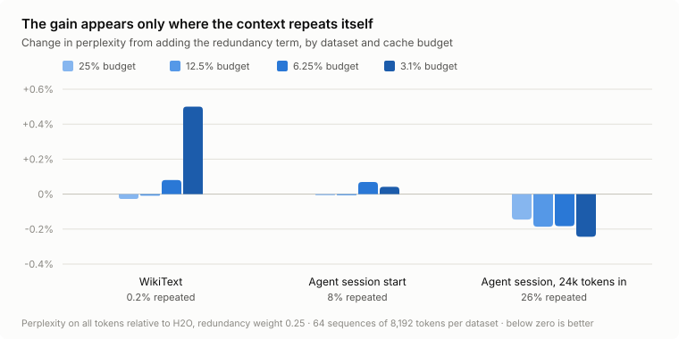
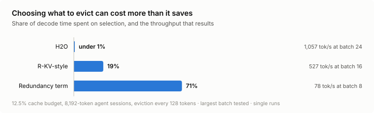

# SubCache

Results write-up: https://sky1219.github.io/SubCache/

My goal as a researcher and coder is always to push for efficiency and speed wherever possible.
My research is in subset selection for ML, where I use submodular functions (functions with
diminishing returns) to pick the most useful subset out of a bigger set. Recently I've gotten
interested in inference optimization and how the hardware behind a model affects how fast it
runs, and I saw a chance to combine the two.

So this project asks one question: when an LLM's KV cache gets too big and you have to throw
tokens away, can a submodular function pick what to keep better than the usual heuristic?

The usual heuristic is H2O, which keeps the tokens that have received the most attention. My
version adds a weighted facility location term (`wfl` in the code) on top of it, so that if two
cached tokens are basically duplicates, only one of them needs to stay.

While the results weren't great, it was still a fun experiment. H2O turned out to be very hard
to beat. My method did win, but only on repetitive text and only by a little, and it was much
slower.

## What I ran it on

Everything runs on one RTX 2080 Ti (11 GB) in fp16. The main model is deepseek-coder-1.3b, and
I used TinyLlama for the early experiments. For data I used real coding-agent sessions from
`nebius/SWE-rebench-openhands-trajectories`, because agents re-read the same files and logs
over and over, plus WikiText as a control with almost no repetition.

The engine has its own KV cache instead of using Hugging Face's, so tokens can be masked out or
physically removed.

Text goes in 64 tokens at a time, and after each chunk the cache is cut back down to its
budget. Every policy keeps the first 4 tokens and the newest half of the budget, so they only
differ in which older tokens they keep. I measure perplexity on the part of the sequence where
the cache is actually over budget, and compare policies on the same sequences.

## Eviction is worth it, mostly because of memory

<picture>
  <source media="(prefers-color-scheme: dark)" srcset="figures/throughput-dark.svg">
  
</picture>

With 8,192-token contexts, the full cache only fits 4 sequences on the card. Keeping a quarter
of it fits 12, which is 2.8x the throughput for about 5% worse perplexity.

Something I didn't expect: a smaller cache doesn't make each step faster. A decode step takes
about 21 ms no matter the batch size or cache size. It turns out that on this machine decoding
is limited by the CPU launching GPU kernels, not by the GPU. I checked by running the same
thing on an RTX A6000 in the same box and got the same 21 ms. So all of the speedup comes from
fitting more sequences in memory.

## Does the submodular part help?

<picture>
  <source media="(prefers-color-scheme: dark)" srcset="figures/redundancy-dark.svg">
  
</picture>

A little. On agent sessions it beat H2O at every budget I tried, and the gap grew as the budget
shrank, but we're talking 0.2% to 1.4% lower perplexity on the agent's own tokens.

<picture>
  <source media="(prefers-color-scheme: dark)" srcset="figures/repetition-dark.svg">
  
</picture>

The part I find most convincing is where it helps. I measured how repetitive each dataset is
(how often a run of 16 tokens has already appeared earlier in the same sequence):

| Data | Repetition | Did my method help? |
|---|---|---|
| WikiText | 0.2% | No |
| Start of an agent session | 8% | No |
| 24k tokens into an agent session | 26% | Yes, at every budget |

It only helps where there is redundancy to remove, which is what the math says should happen.

## Why I wouldn't actually use it

<picture>
  <source media="(prefers-color-scheme: dark)" srcset="figures/selection-dark.svg">
  
</picture>

Picking what to evict isn't free. H2O's choice is basically a sort. Mine has to compare cached
tokens against each other in every attention head, and at a 12.5% budget that took 71% of the
decode time. Throughput dropped to 78 tok/s, which is worse than not evicting at all (190). A
1% accuracy gain doesn't pay for that.

## Limitations

Because my machine was CPU bound, the true effect on speed is hard to know. Decode speed was
identical at every cache size due to CPU limitations.

These are also small models, and I measured perplexity, not whether an agent actually finishes
its task.

## Running it

```bash
pip install torch transformers datasets
python tests/test_policies.py
python scripts/gate.py                              # needs a GPU
python scripts/run_eviction.py --n-seqs 8           # small sweep on WikiText
python scripts/analyze.py results/batch/core8k_late.jsonl --masked
python scripts/make_figures.py
```

The engine is in `subcache/engine.py`, the eviction policies in `subcache/policies.py`, and the
evaluations in `subcache/evals.py`. `scripts/` has the correctness gate, the sweeps, the speed
benchmark and the figure code. `results/` has the raw numbers behind everything above.

## Credit

- H2O: Zhang et al., 2023
- PRISM: Kothawade et al., AAAI 2022
- R-KV: Cai et al., NeurIPS 2025
- Agent trajectories: `nebius/SWE-rebench-openhands-trajectories` (CC-BY-4.0)

This was written with Claude, but I am currently working on hand making my own inference engine
from scratch.
