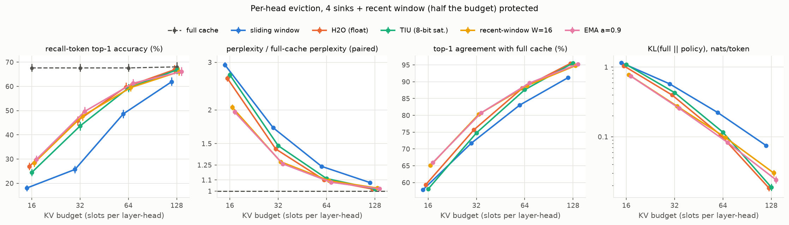
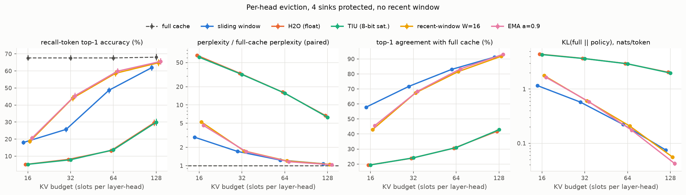

# Streaming KV eviction on Reef's workload (TinyStories-28M)

*Akash · October 2026 · code, tests and raw JSONL in this folder; `python -m reef.reproduce` regenerates every number and figure*

## Question

The TIU evicts continuously during decode by H2O score (accumulated attention mass, argmin
victim). In SubCache, H2O compressed *once* after prefill collapsed on retrieval at small
budgets. Does it drop early-but-important tokens when it evicts **every step**, on Reef's actual
model, and is a cheap alternative better?

## Findings

1. **With a protected recent window, H2O holds up.** On *recall tokens* (names and content words
   reused ≥ 32 tokens after their last mention, the retrieval analog), H2O is within 4 points of
   the best policy at every budget with 4 sinks + a recent window. The budget dominates: vs full
   cache, every score-based policy loses 18–24 recall points at 32 slots per (layer, head), 6–9
   at 64, 1–3 at 128. Your gold config (no sinks, recent C/2) gives the same H2O result within
   1 point at every budget.
2. **Without the recent window, H2O and the TIU collapse at every budget**: recall 5–30%,
   perplexity 6–66x full cache, even at 128 slots. A new token's single row of attention cannot
   outscore older tokens' accumulated mass, so it is evicted on arrival. **The TIU's recent-window
   wrapper is load-bearing.**
3. **EMA (score ← α·score + attention, α = 0.9) is better at tight budgets and needs no wrapper.**
   Over H2O: +2.9 / +3.9 / +1.5 recall points at 16 / 32 / 64 slots with 4 sinks + recent, and
   +9.2 / +6.6 / +1.8 under your gold config (paired 95% CIs exclude 0), with perplexity 1.70x vs
   2.50x full at 16 slots and 1.23x vs 1.43x at 32. At 128 it is 0.6–0.8 points worse. Without
   any protected window it matches protected H2O at 64 slots (59.8% vs 59.8%). Hardware cost: one
   shift-subtract per slot if α = 1 − 2⁻ᵏ (0.875 untested).
4. **TIU numerics:** mapping attention 1.0 → weight 255 saturates the 8-bit score: 17–28% of
   evictions at 16–64 slots pick among candidates all stuck at 255 (ties → lowest slot index).
   With 4 sinks protected outside the scorer that costs ~2 recall points at 16–32 slots; under
   your gold config it costs nothing measurable (|Δ| ≤ 0.3), despite as many ties. Mapping
   1.0 → 32 (a 3-bit shift) removes saturation and matches or slightly beats float H2O in both
   configs (−0.1 to +0.9 points).
5. **Your KV Cache Engine codecs do not change the eviction picture.** With ChannelQuant CQ-4+
   keys and CQ-3-rot (WHT-rotated INT3) values, the full cache itself loses 4.6% perplexity and
   1.5 recall points vs fp32. Eviction losses on top are unchanged (H2O −41.4 / −22.3 / −7.8 /
   −1.4 recall points vs −40.7 / −21.8 / −7.9 / −1.2 in fp32), as is the policy ranking, and key
   group G = 32 performs like your default G = 128.
6. **One keep set per layer costs recall at tight budgets** (H2O: −10.2 points at 32 slots,
   −4.8 at 64, −1.3 at 128, vs per-head).
7. **Sliding window is worst on recall** (−19 points vs full at 64 slots; H2O −8), though it
   loses only 3.8 points of overall accuracy there. Recall tokens are where eviction shows: H2O at
   64 slots loses 2.3 points overall but 7.9 on recall tokens. This model barely needs attention
   sinks: dropping them costs the window at most 2 points.
8. **Robustness:** with simulated int8 weights every recall gap to full cache moves by ≤ 0.4
   points. Evicting global layers only cuts H2O's loss at 32 slots from 21.8 to 6.4 points, but
   the local layers then hold nearly the whole story (~3.6x the KV), so it is no saving here.

| recall-token top-1 %, per-head | B=16 | 32 | 64 | 128 |
|---|---|---|---|---|
| full cache | 67.6 | 67.6 | 67.6 | 68.1 |
| sliding window + sinks | 18.0 | 25.7 | 48.7 | 61.9 |
| H2O (float), 4 sinks + recent B/2 | 26.9 | 45.8 | 59.8 | 66.9 |
| TIU, 8-bit, weight = 255·attn | 24.5 | 43.6 | 59.3 | 66.8 |
| TIU, 8-bit, weight = 32·attn | 26.9 | 45.8 | 60.4 | 66.9 |
| recent-window attention, W=16 | 28.4 | 47.8 | 59.5 | 66.0 |
| EMA α=0.9 | 29.9 | 49.7 | 61.3 | 66.1 |
| H2O, your gold config † | 27.8 | 45.9 | 59.6 | 66.8 |
| EMA α=0.9, your gold config † | 37.0 | 52.5 | 61.5 | 66.2 |
| full cache, your KV codecs (G=128) † | 66.1 | 66.1 | 66.1 | 66.3 |
| H2O, your KV codecs (G=128) † | 24.6 | 43.8 | 58.3 | 64.9 |
| *EMA α=0.9, no recent window* | *20.6* | *45.4* | *59.8* | *65.5* |
| *H2O, no recent window* | *5.2* | *8.1* | *13.3* | *29.5* |

† GPU runs, each paired with a full-cache reference from the same device and numerics. 95% CIs on
recall are ±1.5–2 points; paired differences between policies are tighter. No policy did better
without the recent window than the best policy with it. All tables: `results/summary.md`.

More: `figures/gold_config.png`, `figures/kvq_G128_protected.png`, `figures/int8_protected.png`.

## Setup

- **Model:** `roneneldan/TinyStories-28M` (GPT-Neo: 8 layers alternating global/local with a
  256 window, 16 heads × 32, d = 512; 52.0M parameters incl. the 25.7M tied embedding/lm_head),
  fp32.
- **Engine and gate:** a manual GPT-Neo decode loop with a slot-addressed cache (a new token
  takes the freed slot, as in the TIU wrapper). Full-cache logits match HF to 4e-5; under
  streaming eviction every policy matches an HF forward with per-head masks to 7e-5 even though
  slots are scrambled. GPT-Neo's absolute positions live in the cached K/V, so eviction needs no
  position fix-up: verified, not assumed (`tests/test_gate.py`). The main sweep ran on CPU and
  again on GPUs (RTX 2080 Ti / A6000); all 140 configs agree to ≤ 0.15 recall points and
  ≤ 0.04% perplexity (`results/device_check.md`).
- **Data:** 500 TinyStories-valid stories (seed 0, uniform among those of 160–512 tokens; median
  201), teacher-forced, token by token. 3,897 recall tokens (620 names).
- **Protocol:** after each token, any (layer, head) holding more than B tokens evicts its
  lowest-scoring unprotected token, in all layers (local layers first drop tokens outside their
  window). Protection: 4 sinks + newest round(B/2); 4 sinks only; or your gold config (no sinks,
  recent window L = round(C/2) counting the current token, C = B + 1 tokens per query, which
  matches your evict-then-attend order). Policies: sliding window; H2O; TIU (8-bit saturating,
  bit-exact vs a port of `token_importance_unit.sv`); recent-window attention (W = 8/16/32); EMA
  (α = 0.9/0.99). Metrics only on positions after the first eviction; paired bootstrap CIs.
- **Variants:** int8 = per-channel weight-only fake quantization. KV codecs (`kvquant.py`) = your
  ChannelQuant CQ-4+ keys and CQ-3-rot values, bit-exact vs scalar ports of
  `kv-cache-engine`'s reference, applied in streaming order: keys sit in an FP16 residual until
  their group of G tokens closes, then are quantized with frozen per-channel scales; 2 FP16
  outlier channels per (layer, head) from a mask calibrated on 64 held-out stories.

## Hardware cost (arithmetic from the config; `hw_cost.py`)

Assumptions: int8 weights, HyperRAM 90 MB/s, 32 KB DTCM, 16 MHz, weights streamed each token,
8-bit attention probabilities into the scorer, serial argmin at 1 compare/cycle.

- **KV:** int8 K + V is 1 KB per token per layer, 8 KB for all layers; **DTCM holds 4 tokens of
  KV for the whole model**. With your codecs it is ~4.2 KB per token (34 B per head: 30 INT4 +
  2 FP16 key channels, 32 INT3 values, scales), still only 7 tokens of DTCM.
- **Key-group buffer:** a key group sits in FP16 until it closes, i.e. G tokens × 8 KB (FP16 keys,
  all layers) = **1 MB at G = 128**, about 4x the whole codec cache at 64 slots (~270 KB). At
  Reef-sized budgets the residual buffer, not the cache, dominates; G = 32 (256 KB) costs nothing
  measurable in accuracy here.
- **Traffic per token:** weights 50.9 MB → 566 ms, **half of it the tied lm_head**. int8 KV
  reads at B = 16 / 64 / 128 add 1.5 / 5.9 / 11.7 ms (0.3–2% of the total). **At these budgets
  eviction buys capacity, not bandwidth.**

| policy | state/slot | extra buffer | work per (layer, head) per token, N = 128 | scorer state, whole model: per-head (shared) |
|---|---|---|---|---|
| sliding window + sinks | – | ring pointer | – | 0 |
| H2O / TIU | 8 b | – | 129 add + argmin (129 cycles) | 16 KB (1 KB) |
| EMA, α = 1 − 2⁻ᵏ | 16 b | – | 129 shift-sub + 129 add + argmin | 32 KB (2 KB) |
| recent-window, W = 16 | 8 b | last W attention rows | 258 add/sub + argmin | 274 KB (17 KB) |

The per-head argmin is 16.5k cycles (1 ms) per token. Per-head H2O state at 128 slots is half
the DTCM; recent-window attention needs W rows per head and does not fit; EMA gets most of its
benefit with no buffer.

## Notes for the TIU team

- **Your H2O simulation is optimistic.** `analysis/h2o_analysis.py` re-selects each query's
  top-k from full-cache cumulative attention, so evicted tokens can return and scores never see
  earlier evictions. Its rule run on this model at equal budgets (`sim.py`) reports a smaller
  loss than true streaming: recall −4.9 vs −7.9 points at 64 slots, −14.8 vs −21.8 at 32 (paired
  differences +2.9 [2.0, 3.8] and +7.0 [5.8, 8.2]). Its one-row lookahead explains only 0.7–1.6
  of those points; the rest is non-permanent re-selection. Your +1% perplexity at 25% on WikiText
  also used a 4x larger absolute cache (256 tokens); this simulation reaches +1.2% only at 128
  slots. The 8-bit study quantizes the final sum over [0, T], which a streaming adder cannot do.
- **Weight scale is a design parameter** the RTL leaves open (finding 4).
- **Argmin edge case:** the scan seeds with slot 0 and uses strict `<`; if protection were added
  by excluding slots and every candidate sat at 255, EVICT would return slot 0 whatever it holds.
- **KV path:** the 128-token FP16 key residual is larger than the cache at small budgets (above).

## What this does and does not replicate

Replicated: the model exactly; permanent streaming eviction with slot reuse; the TIU core's
arithmetic and tie rule; your gold protection config and its ordering; your KV codecs bit-exact.

Not replicated, or assumed:
- **Numerics:** the attention block's INT8 S·V routing is not modeled; activations are fp32; the
  KV codecs and int8 weights were run separately, never together. The real codecs are
  discontinuous: last-bit differences between two correct implementations flip 3–9% of top-1
  predictions, so absolute codec numbers carry that sensitivity (policy comparisons are paired
  on one engine and do not).
- **Open spec points, my choices:** the attention→8-bit weight scale; how the wrapper protects
  tokens (the core has no protection input); a key group's scales use its members still cached
  when it closes.
- **Scale of the hardware:** per-head eviction at 128 slots implies 128 score banks of 128
  entries; the TIU is a 4- (Tiny Tapeout) or 8-slot single bank. Per-head results assume that
  can be built.
- **Not found, not modeled:** the "SnapKV soft-mix" and "Q2 re-prefill" named in the
  tt-longhorn-tiu README do not appear in token-importance-unit's `main` or `rtl` branches.
- **Usage:** teacher-forced 160–512-token stories, not a prompt plus free generation at Reef's
  real context. The TIU is a Lambda block; whether it sits in Reef's data path is not assumed.
- `sim.py` applies your simulation's rule with this study's accounting (absolute budgets, sinks,
  B + 1 tokens per query, local window); it is not your script run verbatim.

## How this compares with prior work

- *StreamingLLM* says window + sinks leaves the context window "unchanged": consistent with its
  low recall here. *RoCo* also puts H2O well ahead of it (AlpacaEval BLEU 63.0 vs 47.3 at 250
  tokens); *TOVA* found them tied on PG-19 perplexity (10.22 vs 10.28 at 64 tokens), where here
  H2O leads (1.10x vs 1.24x), plausibly from TinyStories' heavy name reuse (untested).
- *RoCo* traces H2O's weakness to accumulation under-scoring recent tokens; *TOVA* (newest query
  only, no fixed window or sinks) beats H2O. Finding 2 is the extreme form; recency-aware scores
  fix it, smaller W better without protection, TOVA's direction. H2O's own ablation also degrades
  with heavy hitters alone (Winogrande 51.9 vs 68.6 full, OPT-13B).
- Per-head beats shared here and in your Qwen2 study; *TOVA* found head-averaging better for its
  last-token score (W=1, untested here).
- *SubCache* (one-shot, Llama-3.1-8B, RULER-style) had H2O *below* the window at ≤ 25% and a
  question-aware score near full. In streaming H2O beats the window everywhere and recency scores
  gain 2–9 points: plain continuation has no question to look from.
- *SpAtten* (HPCA 2021) pruned tokens permanently by cumulative attention with an on-chip top-k;
  the TIU follows that line with a serial argmin.

## Limitations

- Short contexts (160–512 tokens): 128 slots is most of a story; the transferable part is the
  ranking and the knees, not absolute budgets for Reef's real context.
- Teacher-forced next-token metrics, not free generation; one model, one dataset.
- The recall probe is a heuristic (word-initial tokens, string match, stop-word list) and
  includes generic content words.
- Not tested: α = 0.875, TOVA's W = 1 score, budgets between the tested points, global-only
  eviction at equal memory.
